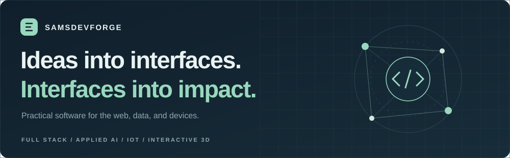
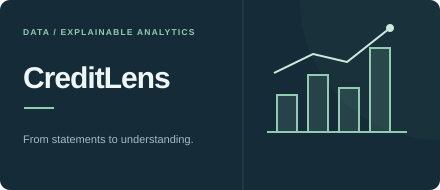
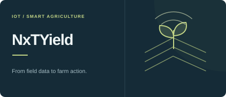
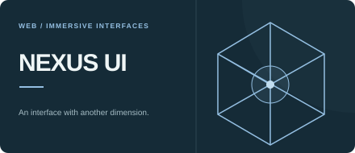
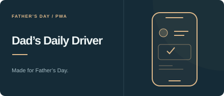
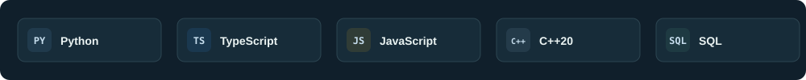

<picture>
  <source media="(prefers-color-scheme: dark)" srcset="./assets/hero-dark.svg">
  <source media="(prefers-color-scheme: light)" srcset="./assets/hero-light.svg">
  
</picture>

  <a href="#selected-projects">Selected projects</a> &nbsp;·&nbsp;
  <a href="#tech-stack">Tech stack</a> &nbsp;·&nbsp;
  <a href="#what-i-build">What I build</a>

## Hi, I'm SamsDevForge.

I build practical software where **interfaces, data, and device capabilities** meet. My work spans full-stack web apps, applied AI, connected dashboards, and interactive 3D experiences.

I care about clear interfaces, explainable behavior, and projects that are straightforward to run and understand.

## Selected projects

<table>
<tr>
<td width="50%" valign="top">

### [CreditLens](https://github.com/SamsDevForge/creditlens)

A statement review workspace with validated CSV imports, cash-flow analysis, traceable anomaly flags, comparison tools, and report exports.

`Python` `FastAPI` `SQLite` `JavaScript`

[Explore the code](https://github.com/SamsDevForge/creditlens) · [Verification](https://github.com/SamsDevForge/creditlens/blob/main/docs/VERIFICATION.md)

</td>
<td width="50%" valign="top">

### [NxTYield](https://github.com/SamsDevForge/NxTYield_Final)

An agriculture dashboard connecting sensor data, weather, crop prediction, and AI-assisted insights with a visual digital farm twin.

`React` `Vite` `Three.js` `API functions`

[Explore the code](https://github.com/SamsDevForge/NxTYield_Final) · [Setup](https://github.com/SamsDevForge/NxTYield_Final#readme)

</td>
</tr>
<tr>
<td width="50%" valign="top">

### [NEXUS UI](https://github.com/SamsDevForge/Nexus_UI)

A cinematic landing experience combining interactive 3D, motion, and a focused visual identity.

`Next.js` `TypeScript` `React Three Fiber` `Tailwind CSS`

[Explore the code](https://github.com/SamsDevForge/Nexus_UI) · [Setup](https://github.com/SamsDevForge/Nexus_UI#readme)

</td>
<td width="50%" valign="top">

### [Dad's Daily Driver](https://github.com/SamsDevForge/Dad-s_Daily_Driver_Final)

A mobile-first daily assistant bringing together weather, news briefs, medicine reminders, events, and a document vault.

`React` `Vite` `Express` `PWA`

[Explore the code](https://github.com/SamsDevForge/Dad-s_Daily_Driver_Final)

</td>
</tr>
</table>

## Tech stack

<picture>
  <source media="(prefers-color-scheme: dark)" srcset="./assets/languages-dark.svg">
  <source media="(prefers-color-scheme: light)" srcset="./assets/languages-light.svg">
  
</picture>

| Where I use it | Technologies |
| :--- | :--- |
| **Web interfaces** | React · Next.js · Vite · Tailwind CSS |
| **3D experiences** | Three.js · React Three Fiber · Drei |
| **APIs & data** | FastAPI · Express · SQLite · PostgreSQL |
| **Vision & devices** | MediaPipe · ONNX Runtime · Capacitor · Android |
| **Desktop software** | Electron · Win32 · CMake |
| **Development & delivery** | Git · GitHub Actions · Vercel |

## What I build

- **Useful interfaces:** dashboards and everyday tools that make complex information easier to act on.
- **Applied intelligence:** data analysis and computer-vision experiments with visible inputs and limitations.
- **Connected experiences:** work spanning web apps, device capabilities, geospatial tools, and offline desktop workflows.

---

  <strong>Explore a project. Read the implementation. Follow the next iteration.</strong> 
  Original work is featured above; upstream forks remain credited to their maintainers.

